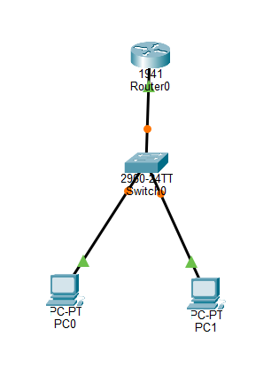

# Project 01 – Small Office LAN


## 1. Project Overview

This project demonstrates the implementation of a basic Small Office Local Area Network (LAN) using Cisco Packet Tracer.

The simulated network consists of one Cisco router, one Layer 2 switch, and two desktop computers. The objective is to establish communication between the workstations through a centralized network switch and configure the router as their default gateway.

### Objectives

- Build a basic LAN topology.
- Understand the roles of routers and switches.
- Configure static IPv4 addresses.
- Configure a router interface using Cisco IOS CLI.
- Understand default gateways and subnet masks.
- Test network connectivity using ICMP ping.

## 2. Network Topology

The network consists of the following devices:

- 1 Cisco 1941 Router (R1)
- 1 Cisco 2960 Switch (S1)
- 2 End Devices (PC1 and PC2)

### Network Diagram



## 3. Network Inventory

| Device Name | Device Model | Role |
|---|---|---|
| R1 | Cisco 1941 | Default Gateway / Router |
| S1 | Cisco 2960 | Layer 2 Network Switch |
| PC1 | Generic PC | Workstation |
| PC2 | Generic PC | Workstation |

## 4. IP Addressing Scheme

The network uses the private IPv4 address range `192.168.10.0/24`.

| Device | Interface | IP Address | Subnet Mask | Default Gateway |
|---|---|---|---|---|
| R1 | GigabitEthernet0/0 | 192.168.10.1 | 255.255.255.0 | N/A |
| PC1 | FastEthernet0 | 192.168.10.10 | 255.255.255.0 | 192.168.10.1 |
| PC2 | FastEthernet0 | 192.168.10.11 | 255.255.255.0 | 192.168.10.1 |

### Network Information

| Parameter | Value |
|---|---|
| Network Address | 192.168.10.0 |
| CIDR Notation | /24 |
| Broadcast Address | 192.168.10.255 |
| First Usable Address | 192.168.10.1 |
| Last Usable Address | 192.168.10.254 |
| Total Usable Hosts | 254 |

## 5. Physical Connections

The following connections were established using Copper Straight-Through Ethernet cables.

| Source Device | Source Port | Destination Device | Destination Port |
|---|---|---|---|
| R1 | GigabitEthernet0/0 | S1 | FastEthernet0/1 |
| PC1 | FastEthernet0 | S1 | FastEthernet0/2 |
| PC2 | FastEthernet0 | S1 | FastEthernet0/3 |

## 6. Router Configuration

The router was configured through its Command Line Interface (CLI).

### Cisco IOS Configuration

```cisco
enable
configure terminal
hostname R1

interface gigabitEthernet 0/0
ip address 192.168.10.1 255.255.255.0
no shutdown
exit

end
copy running-config startup-config
```

### Configuration Explanation

| Command | Description |
|---|---|
| `enable` | Enters privileged EXEC mode |
| `configure terminal` | Enters global configuration mode |
| `hostname R1` | Sets the router hostname |
| `interface gigabitEthernet 0/0` | Selects the router interface |
| `ip address` | Assigns an IPv4 address and subnet mask |
| `no shutdown` | Enables the router interface |
| `copy running-config startup-config` | Saves the configuration |

## 7. Workstation Configuration

Both workstations were configured with static IPv4 addresses through the Desktop > IP Configuration interface in Cisco Packet Tracer.

### PC1

- IP Address: `192.168.10.10`
- Subnet Mask: `255.255.255.0`
- Default Gateway: `192.168.10.1`

### PC2

- IP Address: `192.168.10.11`
- Subnet Mask: `255.255.255.0`
- Default Gateway: `192.168.10.1`

## 8. Testing and Validation

Network connectivity was verified using the Windows Command Prompt available on each simulated workstation.

### Connectivity Tests

| Test | Command | Expected Result |
|---|---|---|
| PC1 to PC2 | `ping 192.168.10.11` | Successful |
| PC1 to R1 | `ping 192.168.10.1` | Successful |
| PC2 to PC1 | `ping 192.168.10.10` | Successful |
| PC2 to R1 | `ping 192.168.10.1` | Successful |

### Router Verification

The following Cisco IOS command was used to inspect interface status:

```cisco
show ip interface brief
```

Expected result: GigabitEthernet0/0 should display an `up/up` status after the physical connection is established and the interface is enabled.

### Testing Evidence

Add screenshots of:

1. Successful ping between PC1 and PC2.
2. Successful ping between a workstation and R1.
3. Router interface status using `show ip interface brief`.

## 9. Troubleshooting

The following troubleshooting procedures can be used when connectivity issues occur.

| Issue | Possible Cause | Recommended Resolution |
|---|---|---|
| Ping request timed out | Incorrect IP configuration | Verify IP address and subnet mask |
| Router unreachable | Router interface administratively down | Execute `no shutdown` |
| No physical connectivity | Incorrect cable or disconnected interface | Inspect Ethernet connections |
| Destination unreachable | Incorrect addressing or routing | Verify IP configuration and gateway |

## 10. Key Learnings

Through this project, I gained practical experience in:

- Understanding basic LAN architecture.
- Identifying the roles of routers and Layer 2 switches.
- Configuring static IPv4 addresses.
- Understanding subnet masks and default gateways.
- Using Cisco IOS CLI commands.
- Enabling router interfaces.
- Testing network connectivity using ICMP.
- Performing basic network troubleshooting.

## 11. Project Files

| File | Description |
|---|---|
| `project-01.pkt` | Cisco Packet Tracer simulation file |
| `topology.png` | Network topology screenshot |
| `README.md` | Project documentation |

## 12. Conclusion

This project established a functional Small Office LAN using Cisco Packet Tracer.

Both workstations were configured with static IPv4 addresses and successfully communicated through the Layer 2 switch. The router was configured as the default gateway for the network.

This exercise provided a foundation for understanding IPv4 addressing, Ethernet switching, router configuration, and basic network troubleshooting.

---

**Next Project:** [Project 02 – Multiple Switches](../project-02-multiple-switches/README.md)

**Tools Used:** Cisco Packet Tracer | Cisco IOS CLI | IPv4 Networking
