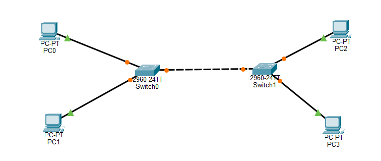

# Project 02 – Multiple Switches LAN


## Project Overview

This project demonstrates how to connect multiple Cisco switches to create a single Local Area Network (LAN).

Using two Cisco 2960 switches, four end devices, and an inter-switch connection, this lab explores how switches forward Ethernet frames using MAC address tables and how devices communicate across multiple switches within the same subnet.

## Objectives

- Connect two Cisco 2960 switches.
- Configure end devices with static IPv4 addresses.
- Establish connectivity between devices connected to different switches.
- Understand how switches learn and maintain MAC address tables.
- Observe how Ethernet frames are forwarded between switches.
- Verify network connectivity using ICMP ping tests.

## Network Topology



### Network Devices

| Device | Model / Type | Quantity |
|---|---|---:|
| Switches | Cisco 2960 | 2 |
| End Devices | PCs | 4 |
| Connections | Ethernet cables | 5 |

## IP Addressing Scheme

All four PCs belong to the same IPv4 subnet: `192.168.20.0/24`.

| Device | Switch | Switch Port | IP Address | Subnet Mask |
|---|---|---|---|---|
| IT-PC01 | SW1 | Fa0/1 | 192.168.20.10 | 255.255.255.0 |
| IT-PC02 | SW1 | Fa0/2 | 192.168.20.11 | 255.255.255.0 |
| HR-PC01 | SW2 | Fa0/1 | 192.168.20.12 | 255.255.255.0 |
| HR-PC02 | SW2 | Fa0/2 | 192.168.20.13 | 255.255.255.0 |

**Default Gateway:** Not configured. All devices communicate within the same subnet, so a router is not required for this lab's connectivity tests.

## Physical Connections

| Source Device | Source Port | Destination Device | Destination Port |
|---|---|---|---|
| SW1 | Gi0/1 | SW2 | Gi0/1 |
| IT-PC01 | Fa0 | SW1 | Fa0/1 |
| IT-PC02 | Fa0 | SW1 | Fa0/2 |
| HR-PC01 | Fa0 | SW2 | Fa0/1 |
| HR-PC02 | Fa0 | SW2 | Fa0/2 |

Copper straight-through cables were used for PC-to-switch connections. The inter-switch connection uses an Ethernet cable supported by the switch interfaces.

## Configuration

### 1. Switch Configuration

Configure the hostname of the first switch:

**SW1**
```cisco
enable
configure terminal
hostname SW1
end
copy running-config startup-config
```

Configure the hostname of the second switch:

**SW2**
```cisco
enable
configure terminal
hostname SW2
end
copy running-config startup-config
```

### 2. PC Configuration

Assign the following static IPv4 addresses through each PC's Desktop > IP Configuration menu:

- IT-PC01: `192.168.20.10/24`
- IT-PC02: `192.168.20.11/24`
- HR-PC01: `192.168.20.12/24`
- HR-PC02: `192.168.20.13/24`

No default gateway is required for communication within this local subnet.

## Verification and Testing

### 1. Connectivity Testing

Use the `ping` command from each PC's Command Prompt to verify connectivity.

Example:

```bash
ping 192.168.20.12
```

Expected results:

| Source | Destination | Expected Result |
|---|---|---|
| IT-PC01 | IT-PC02 | Successful |
| IT-PC01 | HR-PC01 | Successful |
| IT-PC01 | HR-PC02 | Successful |
| IT-PC02 | HR-PC01 | Successful |
| HR-PC01 | HR-PC02 | Successful |
| HR-PC02 | IT-PC02 | Successful |

### 2. MAC Address Table Verification

On both switches, execute:

```cisco
show mac address-table
```

This command displays MAC addresses learned by the switch and the corresponding interfaces.

### 3. Interface Status Verification

Execute:

```cisco
show interfaces status
```

This verifies the operational status of the switch interfaces.

### 4. CDP Neighbor Verification

Execute:

```cisco
show cdp neighbors
```

This helps confirm that SW1 and SW2 can discover each other through Cisco Discovery Protocol.

## Key Networking Concepts Learned

### MAC Address Learning

Switches dynamically learn source MAC addresses from incoming Ethernet frames and associate them with the interfaces where those frames were received.

### MAC Address Table

The MAC address table allows switches to forward Ethernet frames toward the appropriate destination interface instead of sending every frame to every port.

### Frame Forwarding Between Switches

When a device communicates with another device connected to a different switch, the Ethernet frame travels through the inter-switch connection.

### Unknown Unicast Flooding

When a switch does not yet know the destination MAC address, it floods the frame out of the other eligible ports within the same VLAN, excluding the incoming port.

Once the destination responds, the switch can learn its MAC address and update its MAC address table.

### Layer 2 Switching

Both switches operate at Layer 2 of the OSI model, forwarding Ethernet frames based on MAC addresses.

## Troubleshooting Notes

| Issue | Possible Cause | Troubleshooting Action |
|---|---|---|
| PC cannot ping another PC | Incorrect IP address | Verify IP configuration |
| PC cannot communicate across switches | Inter-switch link disconnected | Check cable and interface status |
| Ping request timed out | Incorrect subnet mask | Verify subnet configuration |
| MAC address not appearing | No traffic generated yet | Generate traffic using ping |
| Switch port is down | Cable or interface issue | Check physical connection and interface status |

## Project Files

```text
project-02-multiple-switches/
│
├── README.md
├── project-02.pkt
├── topology.png
│
└── screenshots/
    ├── pc-connectivity-test.png
    ├── sw1-mac-address-table.png
    ├── sw2-mac-address-table.png
    ├── switch-interface-status.png
    └── cdp-neighbors.png
```

## Conclusion

This lab demonstrates how multiple Layer 2 switches can work together to provide network connectivity across different physical segments of a LAN.

By connecting two switches through an inter-switch link, all four PCs were able to communicate within the same IPv4 subnet.

The project provided practical experience with Ethernet frame forwarding, MAC address learning, switch interface verification, and basic network troubleshooting.

## Next Project

**Project 03 – VLAN Configuration**

The next project will introduce Virtual Local Area Networks (VLANs), allowing devices connected to the same physical switching infrastructure to be logically separated into different broadcast domains.

---

*Created as part of my networking fundamentals and hands-on lab portfolio using Cisco Packet Tracer.*
