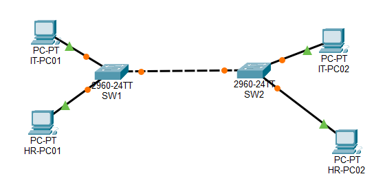

# Project 03 – VLAN Configuration and Network Segmentation


## 1. Project Overview

This project demonstrates how to configure Virtual Local Area Networks (VLANs) across multiple Cisco switches to logically segment a Local Area Network (LAN).

Using two Cisco 2960 switches, four end devices, and an IEEE 802.1Q trunk connection, this lab separates IT and HR workstations into different broadcast domains while allowing devices belonging to the same VLAN to communicate across switches.

The project also demonstrates how VLANs provide logical network segmentation without requiring separate physical switching infrastructure.

## 2. Objectives

- Understand the purpose and benefits of VLANs.
- Create and configure VLANs on Cisco switches.
- Assign switch access ports to specific VLANs.
- Configure an 802.1Q trunk between two switches.
- Allow multiple VLANs to communicate across a single trunk link.
- Verify connectivity between devices in the same VLAN.
- Understand why devices in different VLANs require inter-VLAN routing.

## 3. Network Topology



### Network Devices

| Device | Model / Type | Quantity |
|---|---|---:|
| Switches | Cisco 2960 | 2 |
| End Devices | PCs | 4 |
| Inter-switch Connection | Ethernet trunk | 1 |

### VLAN Design

| VLAN ID | VLAN Name | Network Address | Subnet Mask |
|---|---|---|---|
| 10 | IT | 192.168.10.0 | 255.255.255.0 |
| 20 | HR | 192.168.20.0 | 255.255.255.0 |

## 4. IP Addressing Scheme

| Device | Switch | Switch Port | VLAN | IP Address |
|---|---|---|---:|---|
| IT-PC01 | SW1 | Fa0/1 | 10 | 192.168.10.10 |
| HR-PC01 | SW1 | Fa0/2 | 20 | 192.168.20.10 |
| IT-PC02 | SW2 | Fa0/1 | 10 | 192.168.10.11 |
| HR-PC02 | SW2 | Fa0/2 | 20 | 192.168.20.11 |

**Subnet Mask:** 255.255.255.0

**Default Gateway:** Not configured. This lab focuses on Layer 2 connectivity within individual VLANs. Inter-VLAN routing will be introduced in a future project.

## 5. Physical Connections

| Source Device | Source Port | Destination Device | Destination Port |
|---|---|---|---|
| SW1 | Gi0/1 | SW2 | Gi0/1 |
| IT-PC01 | Fa0 | SW1 | Fa0/1 |
| HR-PC01 | Fa0 | SW1 | Fa0/2 |
| IT-PC02 | Fa0 | SW2 | Fa0/1 |
| HR-PC02 | Fa0 | SW2 | Fa0/2 |

The connection between SW1 and SW2 is configured as an IEEE 802.1Q trunk.

## 6. Configuration

### 6.1 Configure Hostnames

On SW1:

```cisco
enable
configure terminal
hostname SW1
```

On SW2:

```cisco
enable
configure terminal
hostname SW2
```

### 6.2 Create VLANs

The following configuration creates VLAN 10 (IT) and VLAN 20 (HR).

Apply this configuration to both switches:

```cisco
configure terminal

vlan 10
name IT
exit

vlan 20
name HR
exit
```

### 6.3 Assign Access Ports

Configure the access ports on SW1:

```cisco
interface fastEthernet 0/1
switchport mode access
switchport access vlan 10
exit

interface fastEthernet 0/2
switchport mode access
switchport access vlan 20
exit
```

Apply the same access-port configuration on SW2:

```cisco
interface fastEthernet 0/1
switchport mode access
switchport access vlan 10
exit

interface fastEthernet 0/2
switchport mode access
switchport access vlan 20
exit
```

### 6.4 Configure the Trunk Link

Configure the inter-switch connection on SW1:

```cisco
interface gigabitEthernet 0/1
switchport mode trunk
switchport trunk allowed vlan 10,20
no shutdown
exit
```

Configure the same trunk settings on SW2:

```cisco
interface gigabitEthernet 0/1
switchport mode trunk
switchport trunk allowed vlan 10,20
no shutdown
exit
```

The trunk link allows VLAN 10 and VLAN 20 traffic to travel between the two switches.

### 6.5 Save Configurations

On both switches:

```cisco
end
copy running-config startup-config
```

## 7. Verification and Testing

After configuring the VLANs and trunk connection, several commands were used to verify the network configuration.

### 7.1 Verify VLAN Membership

```cisco
show vlan brief
```

This command verifies that VLAN 10 and VLAN 20 exist and that the correct access ports are assigned to each VLAN.

### 7.2 Verify Trunk Configuration

```cisco
show interfaces trunk
```

This command verifies that the inter-switch connection is operating as a trunk and that VLANs 10 and 20 are allowed.

### 7.3 Verify MAC Address Table

```cisco
show mac address-table
```

This command displays the MAC addresses learned by each switch and their corresponding VLANs and interfaces.

### 7.4 Verify Interface Status

```cisco
show interfaces status
```

This command checks the operational status of the switch interfaces.

### 7.5 Connectivity Testing

The following connectivity tests were performed:

| Source | Destination | VLAN | Expected Result |
|---|---|---:|---|
| IT-PC01 | IT-PC02 | 10 | Successful |
| HR-PC01 | HR-PC02 | 20 | Successful |
| IT-PC01 | HR-PC01 | 10 to 20 | Unsuccessful |
| IT-PC02 | HR-PC02 | 10 to 20 | Unsuccessful |

**Test Results:**

- IT workstations successfully communicated across different switches.
- HR workstations successfully communicated across different switches.
- IT and HR workstations could not communicate with each other because they belong to separate VLANs and no Layer 3 routing was configured.

## 8. Key Networking Concepts Learned

### 8.1 Virtual Local Area Networks (VLANs)

VLANs logically divide a physical network into separate broadcast domains.

Devices can belong to different VLANs even when connected to the same physical switch.

### 8.2 Access Ports

Access ports carry traffic for a single assigned VLAN. They are commonly used to connect end devices such as desktop computers and printers.

### 8.3 Trunk Ports

Trunk ports carry traffic from multiple VLANs over a single physical connection between network devices.

### 8.4 IEEE 802.1Q VLAN Tagging

IEEE 802.1Q is a standard used to identify VLAN membership in Ethernet frames transmitted over trunk links.

This allows switches to distinguish traffic belonging to different VLANs.

### 8.5 Broadcast Domain Separation

Each VLAN represents a separate Layer 2 broadcast domain.

For example:

- VLAN 10 broadcasts are restricted to VLAN 10.
- VLAN 20 broadcasts are restricted to VLAN 20.

Broadcast traffic from one VLAN does not automatically cross into another VLAN.

### 8.6 Inter-VLAN Routing

Devices belonging to different VLANs cannot communicate through Layer 2 switching alone.

A Layer 3 device, such as a router or multilayer switch, is required to route traffic between VLANs.

## 9. Troubleshooting Notes

| Issue | Possible Cause | Troubleshooting Action |
|---|---|---|
| PC cannot communicate with another PC in the same VLAN | Incorrect VLAN assignment | Verify using `show vlan brief` |
| Devices on different switches cannot communicate | Trunk link misconfigured | Verify using `show interfaces trunk` |
| VLAN traffic is not passing between switches | VLAN not allowed on trunk | Check allowed VLAN list |
| Incorrect VLAN appears in MAC table | Port assigned to wrong VLAN | Review access-port configuration |
| Interface is down | Physical connection or interface issue | Check cable and interface status |
| IT and HR devices cannot communicate | No inter-VLAN routing | Configure a Layer 3 routing solution |

## 10. Project Files

```text
project-03-vlan-configuration/
│
├── README.md
├── project-03.pkt
├── topology.png
│
└── screenshots/
    ├── vlan-brief-sw1.png
    ├── vlan-brief-sw2.png
    ├── trunk-configuration-sw1.png
    ├── trunk-configuration-sw2.png
    ├── it-vlan-connectivity-test.png
    ├── hr-vlan-connectivity-test.png
    └── mac-address-table.png
```

## 11. Conclusion

This project demonstrated how VLANs can be used to logically segment a network into separate broadcast domains.

By configuring VLAN 10 for IT and VLAN 20 for HR, the network successfully separated the two departments while allowing devices within the same VLAN to communicate across multiple switches.

The IEEE 802.1Q trunk connection enabled both VLANs to traverse a single inter-switch link without requiring separate physical connections for each department.

This lab provided hands-on experience with VLAN creation, access-port configuration, trunking, VLAN tagging, MAC address learning, and Layer 2 network segmentation.

## 12. Next Project

**Project 04 – Inter-VLAN Routing (Router-on-a-Stick)**

The next project will introduce a Cisco router configured with subinterfaces and IEEE 802.1Q encapsulation to enable communication between VLAN 10 and VLAN 20.

---

*Created as part of my hands-on networking fundamentals portfolio using Cisco Packet Tracer.*
