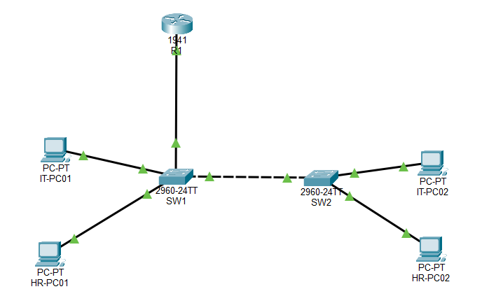

# Project 04 – Inter-VLAN Routing (Router-on-a-Stick)


## 1. Project Overview

This project demonstrates how to configure Inter-VLAN Routing using the Router-on-a-Stick method in Cisco Packet Tracer.

Building upon the VLAN segmentation implemented in Project 03, this lab introduces a Cisco 1941 router to enable communication between devices belonging to different VLANs.

The router uses multiple logical subinterfaces on a single physical GigabitEthernet interface. Each subinterface is configured with IEEE 802.1Q encapsulation and assigned an IP address that serves as the default gateway for its respective VLAN.

This configuration allows devices in separate broadcast domains and IP subnets to communicate through a single physical router connection.

## 2. Project Objectives

- Understand the purpose of Inter-VLAN Routing.
- Configure Router-on-a-Stick using a Cisco router.
- Create and configure router subinterfaces.
- Implement IEEE 802.1Q VLAN encapsulation.
- Configure default gateways for different VLANs.
- Establish trunk connections between switches and the router.
- Enable communication between separate VLANs.
- Verify routing functionality using Cisco IOS commands.
- Troubleshoot VLAN assignment and network connectivity issues.

## 3. Network Topology



### Network Devices

| Device | Model / Type | Quantity |
|---|---|---:|
| Router | Cisco 1941 | 1 |
| Switches | Cisco 2960 | 2 |
| End Devices | PCs | 4 |
| Router-to-Switch Connection | Ethernet trunk | 1 |
| Switch-to-Switch Connection | Ethernet trunk | 1 |

## 4. Network Design and VLAN Configuration

The network is divided into two departments:

| VLAN ID | VLAN Name | Network Address | Subnet Mask |
|---|---|---|---|
| 10 | IT | 192.168.10.0/24 | 255.255.255.0 |
| 20 | HR | 192.168.20.0/24 | 255.255.255.0 |

Each VLAN has its own IP subnet and default gateway.

### 4.1 IP Addressing Scheme

| Device | Switch | Port | VLAN | IP Address | Default Gateway |
|---|---|---|---:|---|---|
| IT-PC01 | SW1 | Fa0/1 | 10 | 192.168.10.10 | 192.168.10.1 |
| HR-PC01 | SW1 | Fa0/2 | 20 | 192.168.20.10 | 192.168.20.1 |
| IT-PC02 | SW2 | Fa0/1 | 10 | 192.168.10.11 | 192.168.10.1 |
| HR-PC02 | SW2 | Fa0/2 | 20 | 192.168.20.11 | 192.168.20.1 |

### 4.2 Router Interface Addressing

| Router Interface | VLAN | IP Address | Subnet Mask |
|---|---:|---|---|
| G0/0 | - | No IP assigned | - |
| G0/0.10 | 10 | 192.168.10.1 | 255.255.255.0 |
| G0/0.20 | 20 | 192.168.20.1 | 255.255.255.0 |

The router subinterfaces serve as the default gateways for their respective VLANs.

## 5. Physical Connections

| Source Device | Source Port | Destination Device | Destination Port |
|---|---|---|---|
| R1 | G0/0 | SW1 | Gi0/2 |
| SW1 | Gi0/1 | SW2 | Gi0/1 |
| IT-PC01 | Fa0 | SW1 | Fa0/1 |
| HR-PC01 | Fa0 | SW1 | Fa0/2 |
| IT-PC02 | Fa0 | SW2 | Fa0/1 |
| HR-PC02 | Fa0 | SW2 | Fa0/2 |

The router-to-switch and switch-to-switch connections are configured as trunk links to carry traffic from VLAN 10 and VLAN 20.

## 6. Configuration

### 6.1 Configure VLANs on Both Switches

Create VLAN 10 and VLAN 20 on SW1 and SW2.

```cisco
enable
configure terminal

vlan 10
name IT
exit

vlan 20
name HR
exit
```

### 6.2 Configure Access Ports

On both switches, assign the appropriate access ports.

```cisco
configure terminal

interface fastEthernet 0/1
switchport mode access
switchport access vlan 10
exit

interface fastEthernet 0/2
switchport mode access
switchport access vlan 20
exit
```

### 6.3 Configure the Inter-Switch Trunk

On both switches:

```cisco
configure terminal

interface gigabitEthernet 0/1
switchport mode trunk
switchport trunk allowed vlan 10,20
no shutdown
exit
```

This trunk carries VLAN 10 and VLAN 20 traffic between SW1 and SW2.

### 6.4 Configure the Router-to-Switch Trunk

On SW1:

```cisco
configure terminal

interface gigabitEthernet 0/2
switchport mode trunk
switchport trunk allowed vlan 10,20
no shutdown
exit
```

This connection allows the router to receive and transmit traffic belonging to both VLANs.

### 6.5 Configure Router-on-a-Stick

On R1, enable the physical GigabitEthernet interface.

```cisco
enable
configure terminal

hostname R1

interface gigabitEthernet 0/0
no ip address
no shutdown
exit
```

Create the VLAN 10 subinterface:

```cisco
interface gigabitEthernet 0/0.10
encapsulation dot1Q 10
ip address 192.168.10.1 255.255.255.0
exit
```

Create the VLAN 20 subinterface:

```cisco
interface gigabitEthernet 0/0.20
encapsulation dot1Q 20
ip address 192.168.20.1 255.255.255.0
exit
```

Save the router configuration:

```cisco
end
copy running-config startup-config
```

### 6.6 Configure Default Gateways on PCs

Each workstation must use the router subinterface IP address corresponding to its VLAN.

| Device | Default Gateway |
|---|---|
| IT-PC01 | 192.168.10.1 |
| IT-PC02 | 192.168.10.1 |
| HR-PC01 | 192.168.20.1 |
| HR-PC02 | 192.168.20.1 |

## 7. Verification and Testing

Several Cisco IOS commands and ICMP connectivity tests were used to verify the network configuration.

### 7.1 Verify Router Interfaces

```cisco
show ip interface brief
```

Expected result:

| Interface | IP Address | Expected Status |
|---|---|---|
| G0/0 | Unassigned | Up |
| G0/0.10 | 192.168.10.1 | Up |
| G0/0.20 | 192.168.20.1 | Up |

The physical interface and both subinterfaces should be operational.

### 7.2 Verify the Routing Table

```cisco
show ip route
```

The routing table should contain directly connected routes for:

- 192.168.10.0/24
- 192.168.20.0/24

These connected routes allow R1 to forward packets between the two VLANs.

### 7.3 Verify VLAN Membership

On both switches:

```cisco
show vlan brief
```

This verifies that the access ports are assigned to their intended VLANs.

### 7.4 Verify Trunk Connections

On both switches:

```cisco
show interfaces trunk
```

This verifies that the trunk interfaces are operational and that VLANs 10 and 20 are allowed.

### 7.5 Connectivity Testing

The following connectivity tests were performed:

| Source | Destination | Expected Result |
|---|---|---|
| IT-PC01 | 192.168.10.1 | Successful |
| HR-PC01 | 192.168.20.1 | Successful |
| IT-PC01 | IT-PC02 | Successful |
| HR-PC01 | HR-PC02 | Successful |
| IT-PC01 | HR-PC01 | Successful |
| IT-PC02 | HR-PC02 | Successful |

**Test Results:**

- IT workstations successfully communicated with their default gateway.
- HR workstations successfully communicated with their default gateway.
- Workstations within the same VLAN successfully communicated across different switches.
- IT and HR workstations successfully communicated with each other through the router.

These results demonstrate successful Inter-VLAN Routing.

## 8. Troubleshooting and Problem Resolution

During the implementation, a connectivity issue was encountered when testing communication between the workstations and the router.

### Issue: Workstations Could Not Reach the Router

**Symptoms:**

Both IT and HR workstations initially failed to communicate with their respective router subinterfaces.

**Investigation:**

The following command was executed on the switches:

```cisco
show vlan brief
```

The output revealed that the switch access ports had not been assigned to their intended VLANs.

**Root Cause:**

Incorrect VLAN membership on the access ports prevented workstation traffic from entering the expected VLAN.

**Resolution:**

The appropriate access VLANs were assigned to the corresponding switch interfaces.

```cisco
interface fastEthernet 0/1
switchport mode access
switchport access vlan 10
exit

interface fastEthernet 0/2
switchport mode access
switchport access vlan 20
exit
```

The configuration was applied to both switches.

**Validation:**

Connectivity tests were repeated after correcting the VLAN assignments. The workstations successfully communicated with their respective default gateways.

### Troubleshooting Lessons

This issue reinforced the importance of verifying the entire network path instead of immediately assuming that the router is responsible for connectivity problems.

The troubleshooting process included:

1. Checking workstation IP configurations and default gateways.
2. Verifying VLAN membership using `show vlan brief`.
3. Checking trunk interfaces using `show interfaces trunk`.
4. Verifying router subinterfaces.
5. Inspecting the routing table.
6. Repeating connectivity tests after applying the correction.

## 9. Key Networking Concepts Learned

### 9.1 Inter-VLAN Routing

Inter-VLAN Routing allows devices belonging to different VLANs and IP subnets to communicate through a Layer 3 device.

### 9.2 Router-on-a-Stick

Router-on-a-Stick uses one physical router interface with multiple logical subinterfaces to route traffic between VLANs.

### 9.3 Router Subinterfaces

Subinterfaces allow a single physical router interface to support multiple VLANs, each with its own IP address and VLAN association.

### 9.4 IEEE 802.1Q Encapsulation

IEEE 802.1Q identifies VLAN membership by adding VLAN tags to Ethernet frames transmitted across trunk links.

### 9.5 Default Gateway

A default gateway provides a path for devices to communicate with destinations outside their local IP subnet.

### 9.6 Layer 2 and Layer 3 Operations

Switches forward Ethernet frames within VLANs using MAC addresses, while the router forwards IP packets between different networks.

## 10. Project Files

```text
project-04-inter-vlan-routing/
│
├── README.md
├── project-04.pkt
├── topology.png
│
└── screenshots/
    ├── router-interface-status.png
    ├── router-routing-table.png
    ├── vlan-brief-sw1.png
    ├── vlan-brief-sw2.png
    ├── trunk-configuration.png
    ├── it-to-hr-connectivity-test.png
    └── troubleshooting-vlan-assignment.png
```

## 11. Conclusion

This project demonstrated how Inter-VLAN Routing can be implemented using the Router-on-a-Stick method.

By configuring router subinterfaces and IEEE 802.1Q encapsulation, the network successfully enabled communication between IT and HR workstations while maintaining separate VLANs and IP subnets.

The lab also provided practical experience in configuring trunk links, assigning default gateways, inspecting routing tables, and troubleshooting VLAN membership issues.

Most importantly, the project demonstrated how Layer 2 switching and Layer 3 routing work together to provide communication across logically segmented networks.

## 12. Next Project

**Project 05 – DHCP and DNS Configuration**

The next project will focus on essential network services, including:

- Dynamic Host Configuration Protocol (DHCP).
- DHCP scopes and automatic IP address allocation.
- Domain Name System (DNS).
- Name resolution and client connectivity.
- Network service troubleshooting.

---

*Created as part of my hands-on networking fundamentals and infrastructure portfolio using Cisco Packet Tracer.*
